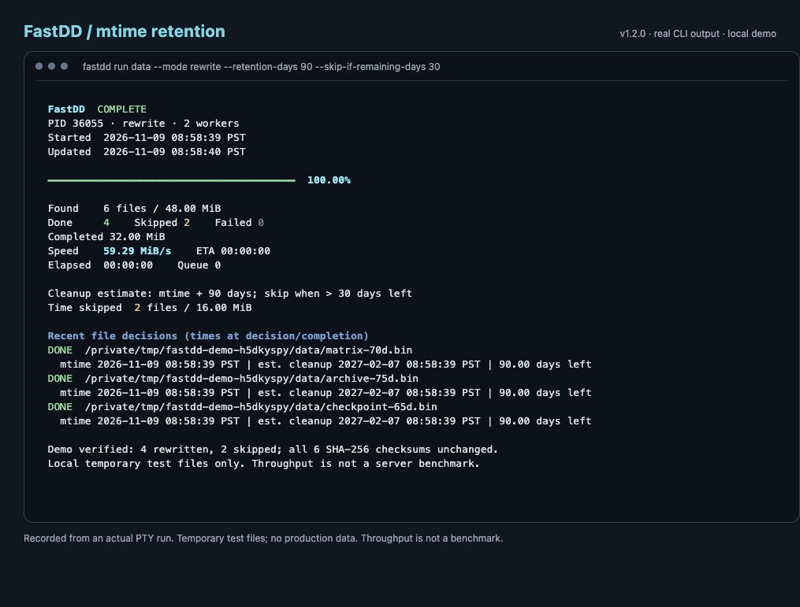

# FastDD

Read or rewrite files in parallel with file-level resume backed by SQLite, colorful live progress, throughput, ETA, and background monitoring. FastDD uses only the Python standard library at runtime and supports Python 3.9+ on Linux and macOS.

[PyPI](https://pypi.org/project/fastdd/) · [Source code](https://github.com/aristoteleo/fastdd) · [Issues](https://github.com/aristoteleo/fastdd/issues)

## See it in action



This screenshot captures a real FastDD 1.2.0 run on macOS using six temporary files totaling 48 MiB. Under a 90-day cleanup policy, four files had no more than 30 days remaining and were rewritten; the other two had more than 30 days remaining and were skipped. SHA-256 checks confirmed that all six files retained their original contents. The displayed throughput reflects this local demonstration only.

The screenshot was taken by replaying the actual PTY output in a browser terminal, preserving the original values and ANSI colors. The raw recording is available in [retention-demo.ansi](docs/screenshots/retention-demo.ansi).

After installing FastDD and cloning this repository, reproduce the demo from the repository directory:

```bash
python examples/retention_demo.py
```

The demo creates temporary test files and removes them after verification. It does not process your existing data.

## Installation

Install from PyPI:

```bash
pip install fastdd
fastdd --version
fastdd --help
```

To use a virtual environment:

```bash
python3 -m venv .venv
source .venv/bin/activate
pip install fastdd
```

After installation, use the `fastdd` command directly. Activate the Python environment containing the installation, or ensure its executable directory is on your `PATH`. You can also install from a local checkout with `pip install .`, or from a wheel with `pip install /path/to/fastdd-1.2.0-py3-none-any.whl`.

## Usage

Read all regular files in a directory:

```bash
fastdd run /data/dataset --mode read --workers 8 --state /tmp/fastdd-dataset
```

Read each file and write the same bytes back in place:

```bash
fastdd run '/data/batch*' --mode rewrite --workers 8 --chunk-mb 32 --fsync --state /tmp/fastdd-rewrite
```

`rewrite` performs actual writes and changes modification times. Use it on files that other programs will not modify during processing. `--fsync` synchronizes each rewritten file before marking it complete. Rewriting does not provide a backup or an atomic replacement.

Run in the background and monitor progress. Keep the log outside the input directories:

```bash
nohup fastdd run /data/dataset --workers 8 --state /tmp/fastdd-dataset > /tmp/fastdd-dataset.log 2>&1 &
fastdd watch --state /tmp/fastdd-dataset
fastdd watch --state /tmp/fastdd-dataset --once
```

Pressing Ctrl+C in `watch` stops the viewer; the background task continues.

Control color output:

```bash
fastdd run /data/dataset --state /tmp/fastdd-dataset --color always
fastdd watch --state /tmp/fastdd-dataset --color never
```

The default, `--color auto`, enables colors in interactive terminals and omits ANSI colors from redirected logs. FastDD respects `NO_COLOR`; an explicit `--color always` takes precedence. Place `--color` before or after the subcommand. Green indicates completion, yellow indicates scanning or skipped files, red indicates errors, and cyan highlights throughput and progress.

## Filter by modification time (new in 1.2.0)

If your server cleans up files 90 days after their last modification time (`mtime`), process only files with 30 days or less remaining:

```bash
fastdd run /data/dataset \
  --mode rewrite \
  --retention-days 90 \
  --skip-if-remaining-days 30 \
  --workers 16 \
  --state /tmp/fastdd-dataset
```

FastDD estimates the deadline as `mtime + 90 days` and calculates remaining days as `(estimated deadline - current time) / 86400`, using timestamps in seconds.

| Time since last modification | Time remaining | Action |
| --- | --- | --- |
| 20 days | 70 days | Skip |
| 59 days | 31 days | Skip |
| 60 days | 30 days | Process |
| 75 days | 15 days | Process |
| 95 days | 5 days past the estimated deadline | Process |

The comparison uses seconds without first rounding to whole days: **skip when more than 30 days remain; process when 30 days or less remain**. `--retention-days` defaults to 90. Filtering is enabled only when `--skip-if-remaining-days` is supplied. Workers recheck mtime before processing to avoid unnecessary work if a file was refreshed while queued.

The dashboard shows task start and update times. With filtering enabled, it also shows mtime, estimated cleanup dates, and remaining days for active and recent files, along with the number of files skipped because they have enough time remaining. Dates use the local time zone of the machine running the command. Active files show their pre-processing timestamps, `DONE` entries show timestamps after completion, and `SKIPPED` entries show timestamps at the skip decision. Remaining days in historical entries do not count down continuously.

With this policy enabled, current mtime determines eligibility. **An old completion record will not cause a file nearing its cleanup deadline again to be skipped.** `--no-resume` does not override the time filter. To process every file, omit `--skip-if-remaining-days` and use `--no-resume`.

`rewrite` writes the original content back and updates mtime. With filtering enabled, empty files are handled by updating their timestamps. `read` does not update mtime and therefore does not extend an mtime-based cleanup deadline; FastDD displays a reminder. Cleanup dates are estimates based on the supplied retention period. Actual cleanup depends on your server's policy and cleanup schedule.

## Resume and status

- Without time filtering, rerunning a command with the same `--state` skips completed files whose path, size, and modification time match the stored record.
- `read` and `rewrite` have separate completion records, so switching modes does not incorrectly skip files. You can reuse a database path from the original standalone script, but files are processed again on the first upgraded run because the old records do not identify the mode.
- Use `--no-resume` to ignore completion records, for example when warming data that may have been evicted from cache. A completion record does not imply that data remains cached. An explicitly enabled time filter still applies.
- Ctrl+C or SIGTERM stops processing after the current I/O call completes. An unfinished file restarts from the beginning on the next run. A blocked system I/O call may delay shutdown.
- State is stored in `<state>.sqlite`, `<state>.status.json`, and `<state>.lock`. The current task's own state files are excluded from scanning. Only one task can use a given state prefix at a time.
- Symbolic links are skipped, and directory symlinks are not followed. A percentage is shown after scanning finishes. Progress includes skipped and failed files; check `Failed` and the exit code to determine success.
- Throughput counts file bytes processed. Since `rewrite` both reads and writes, its displayed rate is not the total underlying storage I/O rate. Cache-warming behavior depends on operating-system and storage-cache policies.
- The default chunk size is 32 MiB per worker. More workers do not necessarily improve throughput.

Exit codes:

| Code | Meaning |
| --- | --- |
| `0` | Success |
| `1` | One or more file-processing or scanning errors |
| `2` | Argument, startup, or state error |
| `130` | Task interrupted |

`watch` returns `0` after successfully displaying status. Inspect the failure count to determine whether the monitored task succeeded.

## Development and verification

```bash
pip install -e .
python3 -m unittest discover -s tests -v
```

Tests operate only on temporary directories. They cover content preservation, mode-specific resume records, state-file exclusion, color policies, partial writes, interruption, time-filter boundaries, overdue and empty files, and interactions between old resume records and time filtering.
